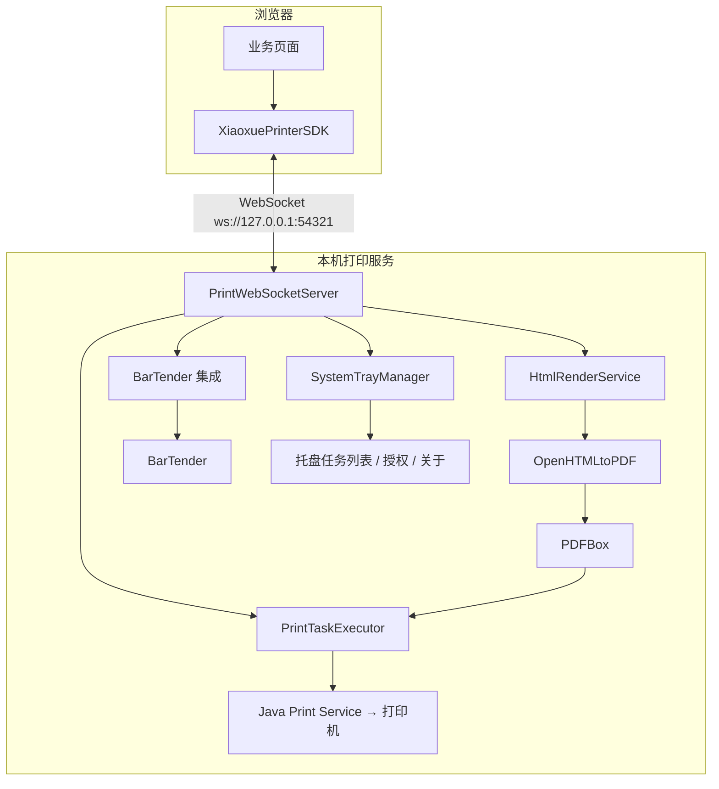

# 技术架构

晓雪WEB打印控件整体分为**本机打印服务**（Java 后端）与 **前端 SDK**（浏览器）两部分，中间通过 WebSocket 通信。

## 系统组成



## 技术栈

| 分类 | 技术 | 说明 |
| --- | --- | --- |
| 运行语言 | **Java 17+** | 服务端主体 |
| 界面 | **SWT 3.131** | 系统托盘、预览窗体、任务列表、关于与授权窗体（默认 Windows x86_64） |
| 通信 | **Java-WebSocket 1.5.6** | 本机 WebSocket 服务端 |
| JSON | **Fastjson2 2.0.64** | 消息编解码 |
| 渲染 | **OpenHTMLtoPDF 1.0.10** + **PDFBox 2.0.31** + **jsoup 1.17.2** | HTML/text 渲染为 PDF |
| 日志 | **SLF4J Simple** | 日志输出 |
| 构建 | **Maven** | 编译打包，shade / jpackage / Inno Setup |

## 源码结构

```
dreamer-print-service/
├── pom.xml
├── xiaoxue-printer-sdk.min.js         # 浏览器 / Node 客户端 SDK（压缩版）
├── xiaoxue-printer-sdk.js             # 浏览器 / Node 客户端 SDK（源码）
├── demo/                              # 演示页（普通打印 + 各框架集成）
└── src/main/
    ├── java/cc/iteachyou/printservice/
    │   ├── MainApp.java               # 启动入口（shade JAR 的 mainClass）
    │   ├── tray/SystemTrayManager.java
    │   ├── websocket/
    │   │   ├── PrintWebSocketServer.java
    │   │   └── PrintTask.java
    │   ├── print/
    │   │   ├── HtmlRenderService.java # HTML/text → PDF
    │   │   ├── PrintTaskExecutor.java # PDF → 打印机
    │   │   └── PaperSizeUtil.java
    │   ├── ui/                        # 预览 / 任务列表 / 关于 / 授权
    │   └── util/
    └── resources/simplelogger.properties
```

## 打印链路

`doPrint` 与预览窗口中的"打印"共用同一链路：

1. **组装文档**：`HtmlRenderService` 将 text / HTML 与 `style` 编成 XHTML，通过 `@page` 设置纸张、边距、页眉页脚，图片内嵌为 base64；
2. **渲染 PDF**：OpenHTMLtoPDF 渲染为 PDF（Windows 注册的宋体 / 微软雅黑等字体自动匹配）；
3. **输出打印**：`PrintTaskExecutor` 使用 PDFBox `PDFPageable` + `PrinterJob` 输出到指定打印机。

## 通信协议概要

WebSocket 消息为 JSON 文本。请求按 `type` 区分，响应使用 `type_result` / `type` 形式：

| 请求 type | 响应 type | 说明 |
| --- | --- | --- |
| `doPrint` | `doPrint_result` | 提交并执行打印任务 |
| `doPreview` | `doPreview_result` | 打开打印预览窗口 |
| `printers` | `printers_result` | 本机打印机列表 |
| `pageSize` | `pageSize_result` | 指定打印机的纸张列表 |
| `list` | `task_list` | 打印任务列表 |
| `status` | `task_status` | 单个任务状态 |
| `cancel` | `cancel_result` | 取消任务 |
| `clear` | `clear_result` | 清除已完成/失败任务 |
| `bartenderInstance` | `bartenderInstance_result` | BarTender 实例与版本 |
| `bartenderTemplateParams` | `bartenderTemplateParams_result` | 模板参数 |
| `bartenderTemplateImage` | `bartenderTemplateImage_result` | 模板图像（base64） |
| `bartenderTemplateImageWithParams` | `bartenderTemplateImageWithParams_result` | 带参数模板图像 |

服务端还会主动推送：

- `welcome`：连接建立后的欢迎消息（含端口等）；
- `task_list_update`：任务状态变化时推送最新任务列表。

> 详细字段与完整示例见 [WebSocket 协议](/api/protocol) 与 [SDK 类参考](/api/sdk)。
