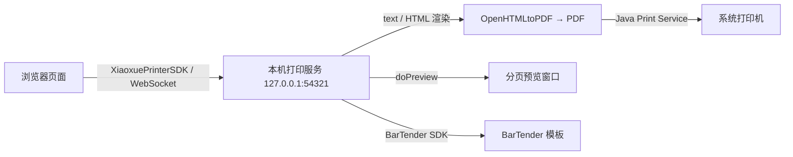

# 产品简介

**晓雪WEB打印控件**（Xiaoxue WEB Printer）是一套基于 **WebSocket** 的本机 Web 打印解决方案。它在用户电脑上以一个**系统托盘常驻服务**的方式运行，网页通过官方提供的 `XiaoxuePrinterSDK` 即可与本机打印服务通信，实现真实、稳定、可预览的打印能力。

## 它解决什么问题

浏览器原生的 `window.print()` 存在诸多限制：无法直接选择特定打印机、无法精准控制纸张与边距、不支持静默打印与批量打印、打印预览样式不可控。而传统浏览器 ActiveX 打印插件又在新版 Chrome / Edge 中逐步失去支持。

晓雪WEB打印控件另辟蹊径：**由本机服务负责"真实打印"，由网页负责"内容与样式"**，两者通过 WebSocket 通信，兼顾了：

- **真实打印**：直接调用系统打印服务（Java Print Service），打印结果与本地软件一致；
- **样式可控**：text / HTML 经 OpenHTMLtoPDF 渲染为 PDF，纸张、方向、边距、页眉页脚、缩放、字体全部可控；
- **浏览器兼容**：任何支持 WebSocket 的现代浏览器（Chrome / Edge / Firefox 等）都可使用，无插件、无驱动安装；
- **框架无关**：纯 JS SDK，Vue / React / Angular 等框架均可轻松集成。

## 核心组成

| 组成 | 说明 |
| --- | --- |
| **本机打印服务** | Java + SWT 编写的托盘程序，监听 `ws://127.0.0.1:54321`，负责渲染 PDF、输出到打印机、维护打印任务、提供预览窗口与 BarTender 集成 |
| **XiaoxuePrinterSDK** | 官方前端 SDK（`xiaoxue-printer-sdk.js`），封装连接管理与全部打印 API，Promise 化调用 |
| **Demo 示例** | 普通打印、打印任务、BarTender、以及 Vue 2 / Vue 3 / React / Angular 集成示例，位于 `demo/` 目录 |

## 工作原理

一次打印的完整链路：

1. 页面通过 SDK 调用 `doPrint()`，将 **打印机、打印样式（style）与打印内容（content）** 以 JSON 形式发送给本机服务；
2. 服务端 `HtmlRenderService` 将 text / HTML 与样式组装为 XHTML（`@page` 控制纸张/边距/页眉页脚，图片自动内嵌）；
3. 使用 OpenHTMLtoPDF 渲染为 PDF（自动匹配 Windows 注册的宋体、微软雅黑等字体）；
4. 通过 `PrintTaskExecutor`（PDFBox `PDFPageable` + `PrinterJob`）输出到指定打印机；
5. 任务完成后自动从任务列表清除，期间任务状态变化会通过 `task_list_update` 事件推送给页面。

## 主要能力一览

- **打印**：`doPrint` 支持文本（text）与富 HTML 片段（html）两种内容类型；
- **预览**：`doPreview` 弹出分页预览窗口，支持缩放、翻页、页面设置、导出 PDF / 图片；
- **打印机与纸张**：动态获取本机打印机列表、指定打印机的可用纸张；
- **任务管理**：任务列表、单个任务状态查询、取消待打印/打印中任务、清除已完成/失败任务；
- **BarTender**：获取 BarTender 实例与版本、读取 `.btw` 模板参数、获取模板图像（支持带参数），配合标签打印；
- **授权与常驻**：机器码授权许可、开机自启、系统托盘任务查看。

## 适用场景

- 企业业务系统的**单据、报表、票据、合同**打印；
- 需要**静默打印 / 批量打印**的仓储、电商、物流场景；
- 需要**套打、标签、条码**的制造业与零售业（结合 BarTender）；
- 需要**精准纸张、边距、分页控制**的财务、医疗、政务系统。

> 下一步：[功能特性](./features) 详细了解各项能力，或直接进入[快速开始](./quick-start)上手体验。
